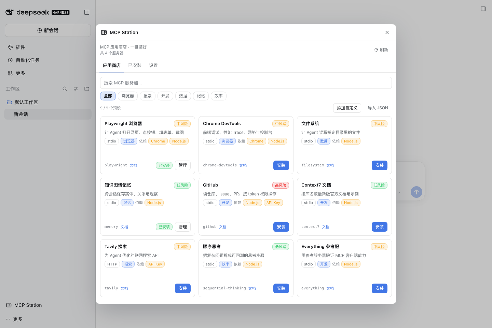
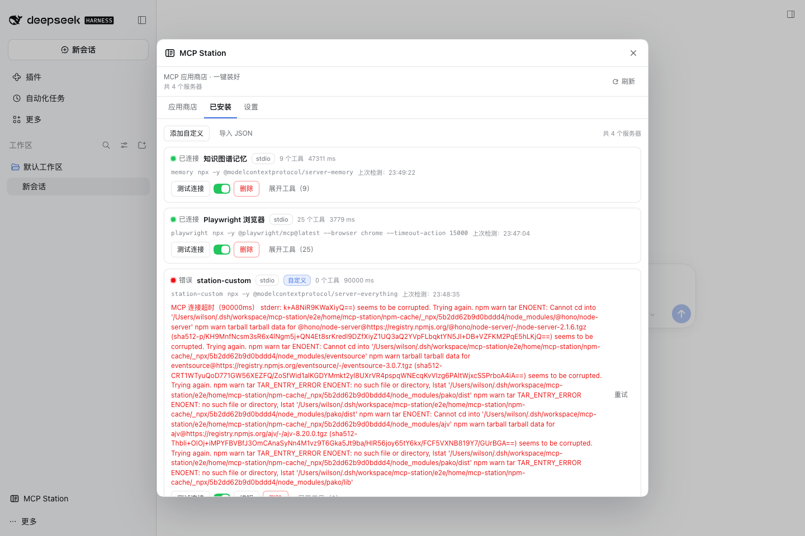

# MCP Station

> The MCP app store for DeepSeek Harness: curated catalog, one-click install, health checks and browser presets.

MCP Station solves three concrete problems for DSH users:

1. **Find it and configure it**: most MCP managers are CRUD panels; installing Playwright still means hand-writing JSON and fighting Chromium revisions. MCP Station ships a curated catalog, writes the config, connects, and runs a smoke check.
2. **Slow markets**: the default market index goes through jsDelivr and often takes 15-25s or times out in mainland China. The MCP Station catalog is bundled with the plugin and works offline.
3. **Did it actually work?**: every entry can be tested (initialize + tools/list) with tool count, latency and error details. The Playwright preset detects local Chrome and adds --browser chrome for you.

## What's new in 0.2.0

- **Aggregated market**: browse every configured market source (picks, the official MCP Registry, and custom sources) with search, source filters, load-more and one-click install.
- **Bigger default catalog**: 26 popular curated presets plus live official-registry search.
- **Custom market sources**: add a JSON source URL with optional name/language/headers; enable, refresh, delete; one bad source never blocks the others.
- **Display language**: follow DSH, Chinese, or English, with automatic fallback.

## What's new in 0.1.1

- **Custom MCP servers**: stdio (command/args/env) or HTTP (url/headers), with validation and a test button.
- **Import JSON**: paste Claude / Cursor mcpServers configs or a servers array; invalid or duplicate entries are skipped with reasons.
- **Auto-test after install**: initialize + tools/list immediately, showing status, tool count and errors; can be disabled in Settings.

## Features

- Curated store: browser, search, dev, data, memory and productivity categories, bilingual copy and risk labels.
- One-click install: writes a managed block into the active profile cordis.patch.yml; DSH HMR loads it in seconds.
- Connectivity test with tool count, latency and errors; Playwright’s first test downloads the server into the npm cache under DSH Home.
- Browser preset that detects Chrome/Chromium and avoids missing bundled Chromium revisions.
- Safety: risk levels, secret redaction, env references that never persist secrets, read-only external rows, YAML validation + atomic replace + 3 backups.
- Environment doctor: profile, patch path, DSH version, Chrome, Playwright cache.

## Install

Desktop: Settings → Plugins → Add plugin → enter dsh-mcp-station → Install → restart/refresh.

CLI:

    dsh plugin --profile web add dsh-mcp-station

## Usage

1. Open MCP Station → Store.
2. Pick Playwright Browser → Install (already carries --browser chrome).
3. In Installed, click Test connection. The first run downloads @playwright/mcp (~30s); then you should see Connected and 25 tools.
4. Go back to the conversation and ask the agent to open a page.

## Presets (26, verified; the table below lists the nine most used)

Playwright Browser, Chrome DevTools, Filesystem, Memory, GitHub (needs GITHUB_PERSONAL_ACCESS_TOKEN), Context7, Tavily (needs API key), Sequential Thinking, Everything.

Also included: Notion, Slack, Linear, GitLab, Postgres, SQLite, Kubernetes, Sentry, Git, MongoDB, Supabase, Excel, Brave Search, Exa, Firecrawl, DuckDuckGo and Apify. See data/catalog.json and docs/presets.md for verification evidence; official-registry entries are searched live from the Market tab.

## Compatibility

- DSH 0.2.x (web / desktop profiles).
- Node.js 22.19+ or 24+.
- macOS / Windows / Linux.

## Development

    npm install
    npm run typecheck
    npm test
    npm run build

E2E: bash e2e/run.sh.

## License

MIT © 2026 WilShi
