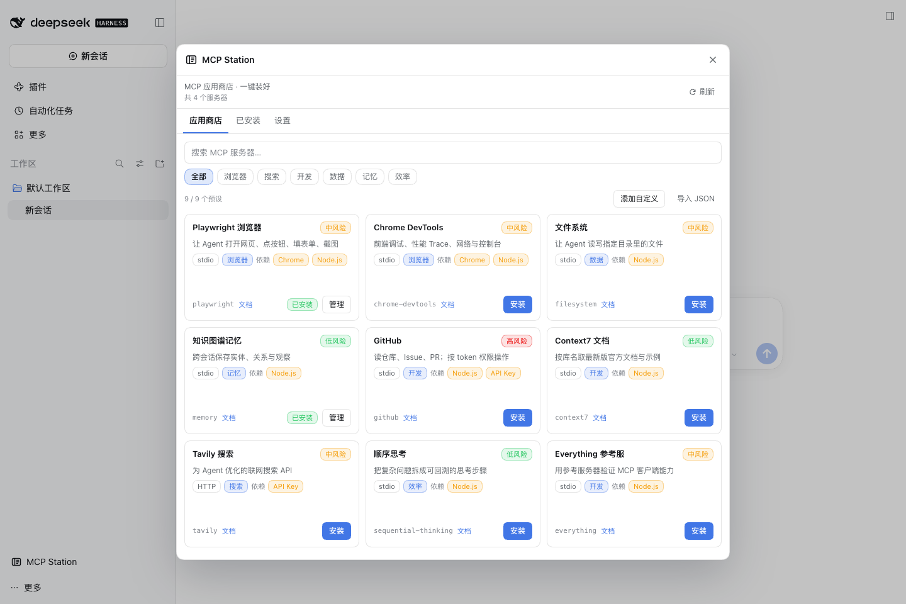
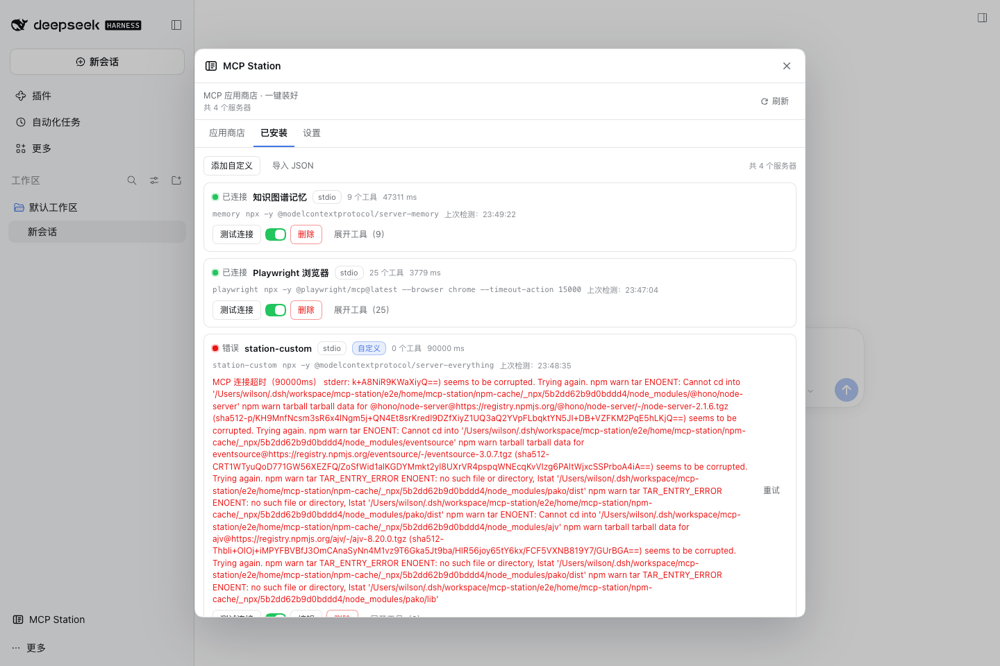

# MCP Station

> DSH 的 MCP 应用商店：精选目录、一键安装、连通性检测、浏览器自动化预设。

MCP Station 是 DeepSeek Harness（DSH）的 MCP 管理插件。它解决三个具体问题：

1. **找不到、配不对**：市面上的 MCP 管理器大多只做 CRUD，安装 Playwright 这类服务器仍要手写 JSON、自己踩浏览器版本坑。MCP Station 内置精选目录，一键写配置、连上、跑通冒烟测试。
2. **市场太慢**：官方插件市场的索引走 jsDelivr，国内经常 15-25 秒甚至超时。MCP Station 的目录随插件打包，离线可用，不依赖任何远程索引。
3. **装完不知道好不好**：每一项都能「测试连接」，列出工具数量、延迟和错误原因；Playwright 预设会自动检测本机 Chrome 并补上 --browser chrome。

## 0.1.1 新增

- **自定义 MCP 服务器**：stdio（command/args/env）或 HTTP（url/headers），带表单校验与测试。
- **从 JSON 导入**：粘贴 Claude / Cursor 的 mcpServers 配置或 servers 数组，一次导入；非法/重名项逐条跳过并给原因。
- **安装后自动测试**：装完立即 initialize + tools/list，状态、工具数、错误直接显示；设置页可关闭。

## 功能

- **精选应用商店**：浏览器、搜索、开发、数据、记忆、效率分类；中英文说明与风险标签。
- **一键安装**：自动写入当前 profile 的 cordis.patch.yml 受管块，DSH HMR 热加载，几秒内工具可用。
- **连通性检测**：initialize + tools/list，显示工具数、延迟、错误；Playwright 首次测试会自动下载服务器（npm 缓存指向 DSH Home）。
- **浏览器预设**：自动检测 Chrome/Chromium，自动加 --browser chrome，避开 Playwright 自带 Chromium 版本缺失。
- **安全管理**：风险分级、密钥脱敏、env 引用不落盘；受管块之外的 MCP 行只读，绝不改动；写入前 YAML 校验 + 原子替换 + 3 份备份。
- **环境体检**：profile、patch 路径、DSH 版本、Chrome、Playwright 缓存一页看清。

## 安装

桌面端：设置 → 插件 → Add plugin / 添加插件 → 输入 dsh-mcp-station → 安装 → 重启/刷新。

命令行：

    dsh plugin --profile web add dsh-mcp-station

装好后左侧栏出现「MCP Station」入口，设置页也有同名分区。

## 使用

1. 打开 MCP Station → 应用商店。
2. 选 Playwright 浏览器 → 安装（默认已带入 --browser chrome）。
3. 在「已安装」里点「测试连接」。首次会下载 @playwright/mcp，约 30 秒；之后看到 Connected 与 25 个工具。
4. 回到会话，让 Agent 打开一个网页试试。

## 预设（9 个，均已实测工具名/参数）

| 预设 | 传输 | 说明 |
| --- | --- | --- |
| Playwright 浏览器 | stdio | Microsoft 官方 Playwright MCP，真实浏览器操作 |
| Chrome DevTools | stdio | 前端调试、网络、控制台、性能 Trace |
| 文件系统 | stdio | MCP 官方 Filesystem，按目录授权 |
| 知识图谱记忆 | stdio | MCP 官方 Memory，本地 JSONL |
| GitHub | stdio | 需要环境变量 GITHUB_PERSONAL_ACCESS_TOKEN |
| Context7 文档 | stdio | 最新库文档，无需 key |
| Tavily 搜索 | streamable-http | 需要 Tavily API key |
| 顺序思考 | stdio | sequential-thinking，拆解复杂问题 |
| Everything 参考服 | stdio | MCP 官方 everything，用来自检客户端能力 |

目录随插件打包在 data/catalog.json；逐项验证证据见 docs/presets.md。

## 安全

- 浏览器类 MCP 会继承你已登录的网页状态；敏感站点请用独立浏览器 profile。
- 桌面自动化类能力请只给可信 Agent；MCP Station 会标注风险级别与原因。
- env 值写 env:NAME 时只写入 !!js process.env.NAME，密钥不落盘；secret 输入不回显。
- 受管块之外的 MCP 配置只读展示，不会被修改。

## 更新日志

- **0.1.1**：自定义服务器（stdio/HTTP + headers）、Claude/Cursor JSON 导入、安装后自动测试。
- **0.1.0**：首个 MVP，9 个精选预设、一键安装、连通性检测、Playwright 预设、环境体检。

## 兼容性

- DSH 0.2.x（web / desktop profile）。
- Node.js 22.19+ 或 24+。
- macOS / Windows / Linux；Chrome 检测覆盖常见安装路径。

## 开发

    npm install
    npm run typecheck
    npm test
    npm run build

构建产物：lib/index.js（宿主）、lib/client.js（浏览器客户端）、data/catalog.json（目录）。E2E：bash e2e/run.sh。

## License

MIT © 2026 WilShi
